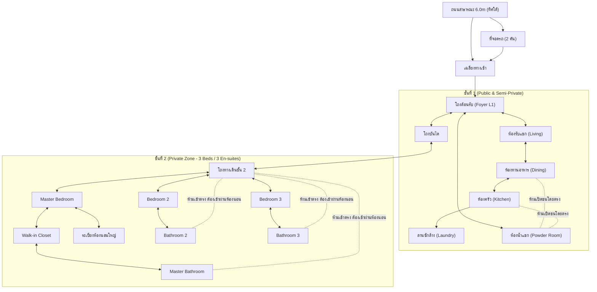

# Modern Tropical Two-Storey Residence (BIM & Spatial Verification Engine)

โครงการออกแบบบ้านเดี่ยวสองชั้นสไตล์ Modern Tropical (3 ห้องนอน 4 ห้องน้ำ) บนแปลงที่ดิน 400 ตร.ม. พร้อมระบบตรวจสอบกฎหมายควบคุมอาคารไทย (Thai Building Regulations) และความสัมพันธ์เชิงพื้นที่ (Spatial & Negative Adjacency Verification)

---

## 1. ข้อมูลแปลงที่ดินและสภาพแวดล้อม (Site Context)

* **ขนาดที่ดิน:** $400.00\text{ ตร.ม.}$ (กว้าง $20.00\text{ ม.} \times \text{ลึก } 20.00\text{ ม.}$)
* **แนวที่ดินและถนน:** ทิศใต้ติดถนนสาธารณะกว้าง $6.00\text{ ม.}$
* **ระยะร่นตามกฎหมาย (กฎกระทรวงฉบับที่ 55):**
  * **ด้านหน้า (ติดถนน 6 ม.):** ร่นจากเขตที่ดินอย่างน้อย $\ge 3.00\text{ ม.}$ (แบบจริงร่น $3.50\text{ ม.}$)
  * **ด้านหลัง:** ร่นจากเขตที่ดินอย่างน้อย $\ge 2.00\text{ ม.}$ (แบบจริงร่น $2.00\text{ ม.}$)
  * **ด้านข้าง (ซ้าย/ขวา):** ร่นจากเขตที่ดินอย่างน้อย $\ge 2.00\text{ ม.}$ (แบบจริงร่น $2.50\text{ ม.}$ และ $4.50\text{ ม.}$)
  * **พื้นที่ว่าง (Open Space Ratio - OSR):** กฎหมายบังคับ $\ge 30\%$ $\implies$ **แบบจริงมีพื้นที่ว่าง $66.38\%$ (ผ่านเกณฑ์)**
* **ระบบสาธารณูปโภคหน้าบ้าน (MEP Points):**
  * ท่อระบายน้ำสาธารณะริมถนนหน้าบ้าน ($Y = 0.0$)
  * ประปาเมน หน้าบ้านทิศตะวันออก ($X = 18.0, Y = 0.0$)
  * ไฟฟ้าเมน หน้าบ้านทิศตะวันตก ($X = 2.0, Y = 0.0$)

---

## 2. ตารางพื้นที่ใช้สอย (Space Programming Schedule)

### ชั้นที่ 1 (Ground Floor — Public & Service Zone)
* **ที่จอดรถ (2 คัน):** $5.50 \times 5.50\text{ ม.}$ ($30.25\text{ m}^2$)
* **เฉลียงทางเข้า (Porch):** $2.50 \times 3.00\text{ ม.}$ ($7.50\text{ m}^2$)
* **โถงต้อนรับและทางเดิน (Foyer L1):** $2.50 \times 4.50\text{ ม.}$ ($11.25\text{ m}^2$)
* **ห้องรับแขก / นั่งเล่น (Living):** $5.00 \times 5.00\text{ ม.}$ ($25.00\text{ m}^2$)
* **ห้องรับประทานอาหาร (Dining):** $5.00 \times 5.00\text{ ม.}$ ($25.00\text{ m}^2$)
* **ห้องครัว (Kitchen):** $4.00 \times 3.50\text{ ม.}$ ($14.00\text{ m}^2$)
* **ลานซักล้าง (Laundry Yard):** $3.50 \times 2.50\text{ ม.}$ ($8.75\text{ m}^2$)
* **ห้องน้ำแขก (Powder Room):** $2.00 \times 2.00\text{ ม.}$ ($4.00\text{ m}^2$)
* **โถงบันได (Stairwell L1):** $2.50 \times 3.50\text{ ม.}$ ($8.75\text{ m}^2$)

### ชั้นที่ 2 (Second Floor — Private Zone)
* **โถงทางเดินชั้น 2 (Upper Hallway):** $2.50 \times 7.00\text{ ม.}$ ($17.50\text{ m}^2$)
* **Master Bedroom + Balcony:** $5.00 \times 7.00\text{ ม.}$ ($35.00\text{ m}^2$)
* **Master Walk-in Closet & En-suite Bath:** $5.00 \times 3.00\text{ ม.}$ ($15.00\text{ m}^2$)
* **Bedroom 2:** $4.50 \times 4.50\text{ ม.}$ ($20.25\text{ m}^2$)
* **Bathroom 2 (En-suite):** $2.50 \times 2.00\text{ ม.}$ ($5.00\text{ m}^2$)
* **Bedroom 3:** $4.50 \times 4.50\text{ ม.}$ ($20.25\text{ m}^2$)
* **Bathroom 3 (En-suite):** $2.50 \times 2.00\text{ ม.}$ ($5.00\text{ m}^2$)

**รวมพื้นที่ใช้สอยทั้งหลัง:** $\approx 231.75\text{ ตร.ม.}$

---

## 3. Function Diagram & Adjacency Rules



---

## 4. การตรวจสอบด้วยสคริปต์อัตโนมัติ (Automated Verification)

รันคำสั่งตรวจสอบ:
```bash
python verify_design.py
```

### การตรวจสอบ 5 ด้าน:
1. **Zoning & Setbacks:** ตรวจสอบระยะร่นหน้าบ้าน $\ge 3.0$ ม., หลัง $\ge 2.0$ ม., ด้านข้าง $\ge 2.0$ ม. และอัตราส่วนพื้นที่ว่าง $\text{OSR} \ge 30\%$
2. **Negative Adjacencies:** ตรวจสอบข้อห้ามทางสถาปัตยกรรม (ห้องน้ำไม่เปิดชนโต๊ะอาหาร, ครัวไม่เชื่อมตรงห้องน้ำ)
3. **Circulation Graph & Reachability:** ตรวจสอบว่าทุกสเปซเดินทางเข้าถึงได้จากเฉลียงหน้าบ้าน ไม่มีห้องใดถูกปิดทึบหรือตกหล่น
4. **En-suite Bathroom Privacy:** ตรวจสอบห้องน้ำในตัวทั้ง 3 ห้องว่าเปิดเข้าได้เฉพาะจากในห้องนอนเท่านั้น
5. **Site & MEP Accessibility:** ตรวจสอบการเชื่อมต่อโครงข่ายทางเข้าออกและระบบสุขาภิบาลหน้าบ้าน
